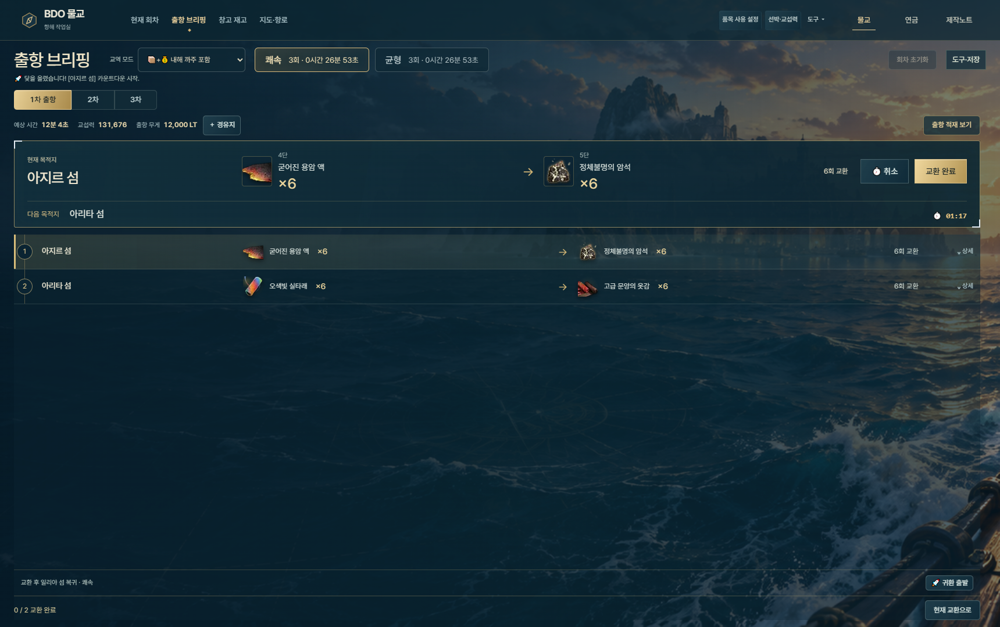
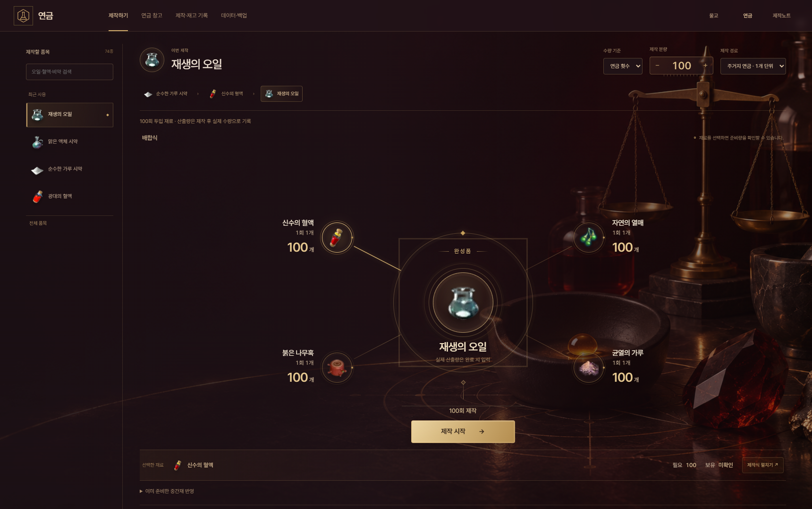
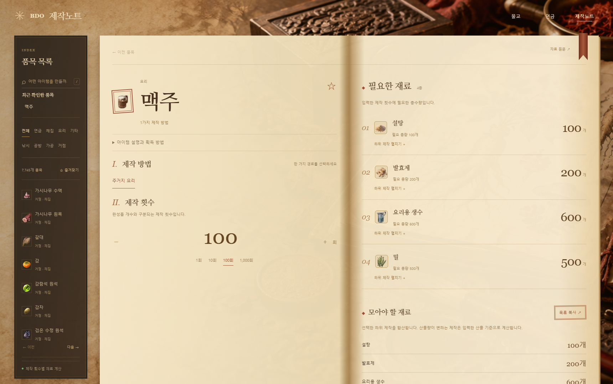

# BDO Suite

검은사막의 **물물교환 준비·연금 제작·제작법 확인**을 한곳에서 돕는 Windows 로컬 작업실입니다.

현재 버전: **1.0.0** · Windows · Python / JavaScript · 로컬 CPU 인식

게임을 직접 조작하는 대신, 사람이 반복하던 캡처·재고 정리·재료 계산·항로 확인을 줄이는 데 집중했습니다. 기존 물교 계산기를 출발점으로, 실제 플레이에서 발견한 불편과 인식 실패를 기록하며 세 개의 작업실로 발전시켰습니다.

[개발 역사](docs/PROJECT-HISTORY.md) · [변경 이력](CHANGELOG.md) · [버전 운영](docs/agents/VERSIONING.md)

## 세 개의 작업실

| 작업실 | 해결하는 일 | 주요 흐름 |
|---|---|---|
| **물교** | 현재 교환 목록과 재고를 정리하고 출항을 준비 | F10 캡처 → 인식·필요한 값 검수 → 회차 적용 → 적재·항로·귀환 브리핑 |
| **연금** | 만들고 싶은 품목에서 필요한 재료와 중간 제작을 바로 확인 | 품목 검색 → 횟수·완성 수량 선택 → 재료 확인·재고 수정 → 제작 시작·실제 결과 기록 |
| **제작노트** | 게임 안에서 제작법을 찾아가며 수량을 곱하는 수고를 줄임 | 품목 검색·최근 내역 → 제작식 선택 → 제작 횟수 입력 → 필요 재료 확인·복사 |

### 물교 · 출항을 따라가는 항해 작업실



- 저장한 게임 영역을 **수동 F10**으로 캡처합니다. 물교와 창고의 영역을 따로 보관합니다.
- 캡처 창 중앙에 스크린샷이 카드로 쌓이며, 개별 삭제·전체삭제를 같은 곳에서 조작합니다. 성공 촬영 때 게임의 영역 테두리도 잠깐 붉게 바뀝니다.
- 검증된 원본 특징과 숫자 모양을 우선 대조하고, 필요한 부분에만 로컬 OCR을 사용합니다. 불확실한 값은 원본과 함께 검수합니다.
- 1–5단 창고 재고 70종, 품목별 목표와 순서, 자동 미사용 품목 설정, 현재 회차와 스케줄 슬롯을 관리합니다. 창고 **이미지 판독 대상은 1–4단**입니다.
- 교역 모드·교섭력·무게·재고를 반영한 쾌속·균형 스케줄을 비교합니다. 브리핑은 **적재 → 교환 항로 → 귀환 → 다음 출항**으로 이어집니다.
- 지도·경유지 자동완성·자유 항로·구간 시간 보정을 제공합니다. 교역 모드는 브리핑 상단에서 바로 바꿀 수 있습니다.

### 연금 · 만들 품목에서 시작하는 제작 작업실



- 완성품과 중간재를 직접 검색합니다. 다른 완성품의 목표 트리를 찾아 들어가지 않아도 제작을 준비할 수 있습니다.
- 연금 횟수 또는 완성 수량을 정하고, 배합식에서 각 재료의 준비량과 하위 제작 경로를 확인합니다.
- 준비 화면에서 필요한 재료의 실제 보유량을 수정해 DB에 저장합니다. 별도 창고 화면도 제공합니다.
- 재고를 추적하는 제작과 **재고 차감 없이 제작 결과만 기록하는 방식**을 선택할 수 있습니다.
- 실제 산출량, 부분 완료·취소·정정과 제작 이력을 관리합니다. 가변 산출 제작식은 완료 기록의 누적 산출량/수행 횟수를 계획에 활용합니다.
- 현재 내장 카탈로그는 **170개 품목·87개 제작식**입니다. 출처·확인 상태를 보존하며 모든 제작식이 독립 검증됐다고 표시하지 않습니다.

### 제작노트 · 횟수만 넣으면 되는 제작법 노트



- **7,745개 품목 색인**에서 제작법을 찾고, 제작 횟수에 따른 필요 재료를 계산합니다.
- 최근 확인 내역과 즐겨찾기, 재료 이미지, 필요량 복사를 지원합니다.
- 재고를 입력하거나 제작에 따라 차감하지 않습니다. 준비한 중간재 반영은 해당 계산에만 사용합니다.
- 품목 색인은 내장하고, 일부 기본 제작식 외의 상세 자료는 처음 조회할 때 원본 사이트에서 가져와 캐시합니다. 재료 이미지는 외부 주소를 사용하므로 인터넷 연결이 필요할 수 있습니다.

화면은 현재 코드에 예시 데이터를 넣어 별도 임시 DB에서 촬영했습니다. 운영 중인 개인 재고·회차를 사용하지 않았습니다.

## 실사용 기록을 개선으로 연결하는 방식

초기에는 OCR 결과의 오차를 보정하는 작업이 많았습니다. 폰트 변경으로 기존 모양 대조가 약해진 뒤에는 **이미 읽힌 문자열을 다시 정답으로 만드는 대신, 실제 캡처의 원본 픽셀과 확인된 라벨을 연결하는 방식**으로 정리했습니다.

```text
일상 사용 중 원본·검수 근거 수집
  → 원본을 직접 대조해 라벨 확인
  → 학습·조정 자료와 평가 자료 분리
  → 이름 표본·숫자 원형 확장
  → 오답 자동 통과·검수량·OCR 호출을 비교
  → 검증한 자료만 앱에 반영
```

저장된 인식 기록을 런타임이 자동 학습해 즉시 정답으로 쓰지는 않습니다. 이름은 품목·섬 마스터로 보정하고, 변동 숫자는 원형 대조와 로컬 OCR의 근거로 판단합니다. 미확인을 실제 `0`으로 바꾸지 않으며 회차·재고 적용은 사용자가 결정합니다. 새 폰트·배율·잘린 화면에서는 검수가 늘어날 수 있습니다.

스케줄도 원본 생성 입력을 제한된 개수로 보관하고, 과거 회차를 별도 환경에서 재계산·비교할 수 있습니다. 모든 스케줄이 전역 최적이라는 주장은 하지 않습니다.

## 구현에서 중요하게 다룬 것

| 선택 | 적용한 이유와 구현 |
|---|---|
| 로컬 CPU 처리 | 외부 AI API 호출 비용이나 GPU 없이 인식. 검증된 대조 자료를 먼저 사용하고 로컬 ONNX OCR로 보완 |
| 원본·후보·확정값 분리 | 인식 문자열, 마스터 보정, 사용자 수정, 검수 사유와 출처를 구분해 다음 개선의 근거로 보존 |
| 저장 성공 뒤 화면 반영 | SQLite 트랜잭션·revision 확인·동일 요청 영수증으로 중복 완료와 응답 유실 재시도의 이중 차감 방어 |
| 앱별 책임 분리 | 실행기·서버는 공유하고, 물교 계산·연금 제작 원장·제작노트 계산과 화면은 분리 |
| 기능에 맞춘 화면 | 항해 브리핑, 중앙 배합식, 제작법 노트에 각각 다른 테마와 작업 흐름 적용 |
| 검증 범위 구분 | 자동 회귀·저장 이미지 재생·설치 앱 확인·실제 게임 F10 확인을 별도 기록 |

## 실행하기

### Windows 폴더 패키지

제공받은 배포 폴더에서 `app/BDO 실행.exe`를 실행합니다. `_internal/`도 함께 있어야 하며 exe만 따로 옮기지 않습니다. 준비 화면에서 로컬 서비스가 시작되면 브라우저가 열립니다.

| 주소 | 화면 |
|---|---|
| `http://127.0.0.1:18765/` | 통합 메인 |
| `/barter/` | 물교 |
| `/alchemy/` | 연금 |
| `/craft/` | 제작노트 |

브라우저를 닫아도 서버는 유지됩니다. 실행 관리 창의 **서버 종료**로 마무리합니다. 게임 창과 앱의 권한 수준은 캡처에 영향을 줄 수 있으며, 기존 실행 설정에 따라 Windows 승인 창이 나올 수 있습니다.

### 소스에서 실행

Windows와 Python **3.12 권장**(기본 앱 3.11 이상)이 필요합니다. Node.js **22 이상**은 JavaScript·브라우저 검증에 사용합니다. 프런트엔드는 별도 빌드 없이 제공됩니다.

```powershell
git clone https://github.com/kwangs7243/JK_BDO.git
cd JK_BDO
py -3.12 -m venv .venv
.venv/Scripts/python.exe -m pip install -e ".[test,ocr]"
.venv/Scripts/python.exe -B -m local_app.launcher
```

물교·창고의 OCR에는 검증된 `inference.onnx`와 `inference.yml`이 추가로 필요합니다. 모델은 Git에 포함하지 않습니다. 기본 위치는 `.local/models/trade/`이고, `BDO_TRADE_OCR_MODEL_DIR`로 바꿀 수 있습니다. 모델 무결성 기준은 [인식 런타임](barter/backend/services/trade_batch_runtime.py)에 있습니다. 모델이 없는 상태에서는 기본 화면·수동 입력·연금·제작노트를 확인할 수 있지만 OCR 사용 가능 상태는 충족되지 않습니다.

개발 실행도 기본적으로 사용자 AppData를 사용합니다. 자동 검증은 별도 임시 DB와 브라우저 프로필에서 수행합니다.

## 저장과 외부 연결

| 자료 | 저장 위치·성격 |
|---|---|
| 물교 재고·회차·설정·인식 이력 | `%LOCALAPPDATA%/BDOBarter/data/bdo.sqlite3` |
| 물교·창고 캡처 영역 | 같은 폴더의 `native-capture-profiles.json` |
| 연금 재고·제작 원장 | `%LOCALAPPDATA%/BDOSuite/alchemy/alchemy.sqlite3` |
| 제작노트 캐시·즐겨찾기 | 연금과 같은 DB의 별도 `craft_*` 테이블. 제작노트 계산은 재고를 차감하지 않음 |
| 최근 화면·최근 확인 품목 등 | 각 화면의 브라우저 저장소 |
| 배포용 인식 자료 | `barter/recognition_data/`. 사용자 DB와 별도로 검증·버전 관리 |

핵심 계산과 물교 인식에 외부 AI 서비스는 필요하지 않습니다. 제작노트 상세 자료·이미지는 [KOR BDO](https://www.korbdo.co.kr/#craft)에서 가져오는 경로가 있습니다. 게임 입력·자동 스크롤·자동 교환은 수행하지 않습니다.

## 소스 구조와 검증

```text
local_app/                 공통 실행기·Flask/Waitress·Windows 캡처·통합 메인
  config.py               앱 버전과 loopback 실행 설정
  frontend/               공통 알림·통신과 메인 화면
  tests/                  임시 데이터로 실행하는 회귀·고정 입력 검사
  packaging/              PyInstaller 폴더 패키지
barter/                   물교 API·SQLite·인식·스케줄·항해 화면
alchemy/                  연금 카탈로그·준비 계산·제작 원장·화면
craft/                    제작노트 색인·상세 캐시·계산·화면
reference/                물교 기준 품목과 아이콘
tools/                    인식 확장·실험·버전 확인 도구
docs/                     개발 역사·화면·유지보수 지침
```

현재 기능은 저장소 루트에서 개발합니다. 과거 `_dev` 경로나 `v14`, `v21` 같은 내부 기록은 당시 자료의 식별자이며 현재 앱 버전과 다릅니다.

```powershell
$env:PYTHON=(Resolve-Path .venv/Scripts/python.exe).Path
$env:PYTHONDONTWRITEBYTECODE='1'
& $env:PYTHON -B tools/check_version.py
& $env:PYTHON -B -m pytest
npm ci
npm run test:domain
npm run test:browser
```

버전만 정리하는 작업에서는 첫 번째 확인 명령이면 충분합니다. 기능 변경은 관련 검사부터 실행합니다. 전체 회귀의 범위와 환경, 실제 게임 검사 구분은 [검증 안내](docs/TESTING.md), 실행 파일 구성은 [패키징 안내](docs/PACKAGING.md)를 참고하세요.

## 개발 역사와 유지보수

- [프로젝트 역사](docs/PROJECT-HISTORY.md): 물교 도우미에서 세 작업실로 발전한 과정과 근거 커밋
- [변경 이력](CHANGELOG.md): v1.0.0 기준판과 이후 실제 패치 기록
- [버전 운영 지침](docs/agents/VERSIONING.md): PATCH/MINOR/MAJOR 판단, 갱신 파일과 완료 절차
- [인식 패치 지침](docs/agents/RECOGNITION-PATCH.md): 원본 감사·표본 확장·독립 비교
- [스케줄 후속 지침](docs/agents/SCHEDULER-FOLLOWUP.md): 회차 수집과 계산 보완의 범위

## 기반과 출처

스케줄 생성은 기존 물교 계산기를 기반으로 보존·보완했습니다. 캡처·검수·저장·인식 자료 확장·통합 앱과 작업 화면은 실사용 요구에 맞춰 발전시켰으며, 세부 근거는 개발 역사에 연결했습니다. Git 이전 원본의 외부 저장소·작성자는 현재 자료만으로 확정하지 않습니다.

게임 정보와 아이콘은 검은사막 및 각 데이터 출처에 기반합니다. 제작노트의 원본 주소·수집일, 연금 제작식의 출처·확인 상태, 폰트의 배포 조건은 해당 데이터와 자산에 보존합니다. 별도 소스 라이선스 파일은 아직 지정하지 않았습니다.
