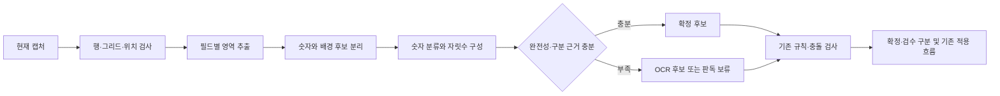

# 실사용 기록 기반 인식 개선 설계

작성: 2026-11-01. 2026-11-02 상태: **실험 후 v21 혼합 실행 경로로 구현**. 아래 본문은 실험 전에 정한 설계·평가 원칙이다. 현재 구현·측정과 후속 확장 절차는 [인식 패치 지침](../agents/RECOGNITION-PATCH.md)을 먼저 읽는다. 단독 코어와 전체 혼합 경로의 지표를 혼동하지 않는다.

## 1. 목표와 결정

현재 게임 폰트와 화면 크기를 유지하는 조건에서, 실사용 기록으로 판독기의 재사용 능력을 개선한다. 같은 품목·수량의 화면을 다시 맞히는 것뿐 아니라 **처음 보는 수량, 다른 아이콘 위의 같은 숫자도 읽는 것**이 성공 조건이다.

결정 사항:

1. 숫자 분리·분류·자릿수 구성을 개선하는 작업을 우선한다. 전체 슬롯/전체 필드 정답은 보조 가속 수단으로 유지한다.
2. 초기 후보는 현재 폰트의 검증된 숫자 원형을 이용한 거리 분류와 가변 폭 숫자열 판독이다. GPU·외부 API는 요구하지 않는다.
3. 모델 학습 여부보다 **평가에 쓰지 않은 실사에서 정확한 자동 처리가 늘었는지**로 판단한다.
4. OCR은 불확실한 경우의 후보 생성·자료 수집에 사용한다. 서로 다른 전처리를 거친 동일 OCR의 일치를 독립 증거 여러 개로 세지 않는다.
5. 현행 v20을 기준으로 별도 실험한다. 이 문서 작성으로 실행 중인 앱·DB·정답 사전은 변경하지 않는다.

유지할 부분: native 캡처와 행/그리드 검사, 아이콘 품목 판독, 유일한 마스터 이름 보정, 기존 교환 규칙, 미사용 정책, 원본/후보/확정값 구분, 사용자의 명시 적용과 재고 저장 계약.

범위 밖: 연금·제작노트, 배차/교섭력 계산, 품목 마스터의 임의 수정, 실제 재고 정정, 게임 입력 자동화. 폰트 변경 일반화를 현재 폰트 성능보다 우선하지 않는다.

## 2. 현재 기준과 자료

2026-11-01 DB 읽기 전용 조회 시점:

| 항목 | 확인한 상태 |
|---|---|
| 물교 이력 | 438건. recognized/reviewed 중복 포함 |
| 서로 다른 캡처 키 | 241개. 모두 같은 폰트의 독립 정답이라는 뜻은 아님 |
| 창고 스캔 | 9건. 폰트·정답 자격은 별도 확인 필요 |
| 활성 물교 사전 | 원본 출처 reference 2,525개 |
| 숫자 글자 reference | 39개. 0~9가 존재하지만 분리 실패를 해결하지 못함 |
| 독립 평가 후보 | v20의 완전한 새 물교 배치 1개/16장 |

16장의 원본 해시는 활성 사전의 `imageSha256` 출처 목록에 없었다. 이 설계 작성에서는 해당 배치의 결과·라벨을 살펴보지 않았다. 이는 사전 출처 미사용 확인이며, 시각적 근접 중복·폰트 확인을 마쳤다는 뜻은 아니다.

개인 캡처 ID와 봉인 목록은 저장소 밖 `recognition-learning-design-20261101/sealed-evaluation-manifest.json`에 보관한다. 원본 이미지·개인 DB는 Git에 추가하지 않는다.

현행 구조의 제약:

- 창고 전체 슬롯 두 마스크 정답은 아이콘과 수량에 함께 의존한다.
- 물교 수량의 context 정답도 아이콘 주변 픽셀을 포함한다.
- 독립 숫자 대조는 밝은 아이콘/희미한 획/붙은 숫자와 불완전한 영역 추출에 영향을 받는다.
- 물교 숫자 OCR fallback은 현재 이미지 근거를 확보하지 못하면 맞게 읽어도 검수로 보낸다.
- 창고는 미확정 OCR 후보를 갖고도 수정란을 빈칸으로 표시한다.
- 전체 정답을 추가한 뒤 재생한 검수 0건은 새 회차 인식 능력의 증거가 아니다.

과거 실험도 보존한다. `docs/decisions/2026-10-19-numeric-recognition.md`에서는 숫자 조합/HOG/분류기 비교의 개선 폭이 작았고, 누락 검사를 풀었을 때 23건 중 12건이 틀렸다. 이 결과는 앞자리 누락을 분류기 교체로 해결할 수 없음을 보여준다. 다른 폰트·다른 시점의 결과이므로 이번 설계의 성공/실패를 대신 판정하지 않는다.

`docs/RECOGNITION.md` 등의 reference 개수, 삭제된 창고 NPZ 경로, 숫자 조합 미적용 설명은 현재 v20과 불일치한다. 이 문서는 실제 코드와 설치 상태를 출발점으로 하며, 기존 안내 문서를 구현 완료 문서로 덮어쓰지 않는다.

## 3. 자료와 정답의 역할 분리

학습 자료와 평가 자료 모두 정답 라벨이 필요하다. **원본/정답 라벨/학습 산출물**을 분리한다.

| 자료 | 내용 | 금지 사항 |
|---|---|---|
| 원본 | 원본 PNG 해시, 캡처·회차·폰트/배율 상태, native 좌표 | OCR 글자를 렌더링해 원본으로 대체하지 않음 |
| 정답 라벨 | 필드의 실제 값, 확인한 원본, 확인 주체·방식·시각·라벨 버전 | 자동 통과·사용자 무수정·OCR 일치를 정답으로 간주하지 않음 |
| 학습 산출물 | 숫자 원형, 배경 음성 표본, 분류/보류 기준, 출처 목록 | 평가 원본에서 추출하거나 평가 결과에 맞춰 수정하지 않음 |
| 판독 결과 | 후보·확정값, 출처, 점수/후보 간격, 영역 완전성, 검수 사유 | 후보를 확정값 또는 실제 0으로 채우지 않음 |

### 정답 자격

- 기존 사용자의 명시적 품목/수량 확인, 수정 및 agent의 원본 직접 대조를 구분해 수용한다. 실제 피드백의 확인 범위를 검사한다.
- `unchecked`, 자동 MATCH, OCR 후보, 마스터 보정 성공은 단독으로 숫자 정답 자격이 없다.
- 규칙으로 채운 값은 규칙 회귀 정답으로 쓸 수 있다. 보이지 않는 숫자 글자의 학습 정답으로 쓰지 않는다.
- 원본에서 숫자가 잘렸거나 읽기 애매하면 라벨은 보류한다. 추측 라벨로 숫자 원형을 만들지 않는다.
- 숫자 전체 라벨과 글자 분할 라벨을 구분한다. 전체 값이 41이라고 알아도 조각 두 개가 올바른 4/1 영역인지 별도 확인한다.
- 자동으로 추출한 글자 조각은 후보이다. 동전·아이콘 획이 붙었거나 일부 획이 사라진 조각을 학습시키지 않는다.
- 1/7, 3/5, 5/6, 앞자리 누락 사례와 변경 라벨은 원본 문맥과 겹치지 않는 확대 화면으로 재확인한다. 불일치하는 라벨은 격리한다.

필드 라벨의 최소 항목:

```text
labelId, labelVersion, imageSha256, captureId, roundGroupId, task,
fontProfileId, fontVerification, field, sourceBox, value,
verificationMethod, verifiedAt, supersedesLabelId
```

글자 학습 후보에는 추가로 `tokenLabelId`, 글자의 원본 좌표, 순서, 실제 글자, 분리 확인 상태를 둔다. UI의 입력값 자체를 원본 이미지처럼 취급하지 않는다.

## 4. 개발·조건 선택·평가 분리

### 분리 단위

캡처 조각을 무작위로 나누지 않는다. **한 물교 배치 전체/한 창고 스캔 전체**를 같은 집합에 둔다. 같은 회차의 겹친 행, 동일 PNG의 recognized/reviewed 기록, 증강 사본도 같은 집합에 둔다.

동일 관측의 재저장·동일/근접 캡처는 묶는다. 서로 다른 관측의 숫자 4가 같은 모양이라는 이유로 모든 4를 한 집합에 몰지는 않는다. 학습한 4를 다른 수량에 재사용하는 능력이 평가 목적이다.

집합 역할:

- **TRAIN:** 원형·음성 표본 및 필요한 분류 파라미터 생성.
- **DEV:** 분리 방법, 분류 거리/후보 간격, 자동/보류 기준 선택. 적어도 한 물교 배치와 한 창고 스캔을 통째로 배정한다.
- **TEST:** 방법과 기준을 고정한 뒤 최종 판정. 결과를 보고 바꾸면 해당 집합은 다음부터 DEV로 이동하며 새 TEST를 확보한다.
- **PROSPECTIVE:** 후보 산출물 동결 이후의 실사용 회차. 최종 실사 확인에 쓴다.

비율을 맞추기 위해 작은 집합을 행 단위로 쪼개지 않는다. 폰트가 확인된 독립 배치가 부족하면 부족하다고 보고한다. 기존에 반복해서 본 자료의 재분리는 과거 자료 평가이며 완전한 새 실사라고 부르지 않는다.

### 기존 활성 사전의 누출 방지

현재 사전은 과거 평가에 사용한 이미지도 이미 포함한다. 실험용 산출물은 허용된 TRAIN 출처만으로 재구성한다. 활성 사전 전체를 불러온 채 TEST 정답만 뺐다고 주장하지 않는다.

분리 검사에는 원본 해시뿐 아니라 원형·정확 일치 캐시·보정 자료·증강 사본의 출처를 포함한다. TEST를 눈으로 확인한 뒤 숫자 원형을 추가하고 같은 TEST를 다시 성능 평가에 쓰지 않는다.

현재 보류한 16장은 TEST 후보로 유지한다. 폰트/중복/라벨 감사를 별도 수행하고, 개발자는 고정 후보 평가 전 그 라벨에 맞춘 코드나 기준 조정을 하지 않는다. 16장만으로 창고 새 실사 검증을 대체할 수 없다.

## 5. 판독 경로



품목 아이콘·섬 이름은 기존의 독립 경로를 유지한다. 숫자 개발을 이유로 정상 마스터 보정이나 스케줄 계산을 바꾸지 않는다.

### 현재 폰트 프로필

- 우선 현재 폰트 하나를 명시적으로 지원한다. 날짜 이후 캡처라는 이유만으로 같은 폰트라고 간주하지 않는다.
- 폰트·숫자 높이·배율·표현 방식이 확인된 자료만 프로필에 배정한다. 불확실한 자료는 분리한다.
- ROI의 화면 위치만 이동한 것은 새 폰트로 취급하지 않는다. 사용자에게 영역을 매번 정확히 같은 좌표로 옮기도록 요구하지 않는다.
- 창고의 흰 수량, 물교 아이콘 위의 흰 수량, 노란 남은 횟수는 추출 조건을 나누고 숫자 분류·자릿수 검증 코어를 공유한다. 실제 분포가 다른 글자 원형의 무조건 혼합은 피한다.
- 다른 폰트/배율로 의심되는 입력이 늘면 프로필 불일치를 한 번에 알린다. 기존 정답을 지우거나 새 폰트를 자동 학습해 덮어쓰지 않는다.

### 숫자 영역 분리

현존 숫자 영역, 그리드와 행 앵커를 활용한다. 전체 슬롯은 품목 확인·원본 문맥에 사용하고, 숫자 분류 입력은 숫자 줄의 획/명암/테두리로 구성한다.

- 숫자의 흰 중심, 어두운 테두리, 주변 배경을 구별한다. 임계값 하나로 모든 밝은 픽셀을 숫자로 취급하지 않는다.
- 학습용 음성 표본에는 밝은 조개/물병/용 조각상, 동전 무늬, 빈칸/추가칸/잠금, 희미한 잔상과 구분선을 포함한다.
- 잘라낸 조각과 함께 원래의 넓은 영역을 검사한다. 앞자리·뒷자리 누락 가능성, 잘린 경계, 설명되지 않는 숫자 후보를 기록한다.
- 배경 잔상이 있다는 이유만으로 항상 누락으로 판정하지 않는다. 다만 근거 없이 그 획을 삭제해 판독률을 올리지 않는다. 배경/숫자 분리 개선은 음성 표본 및 누락 회귀를 함께 통과해야 한다.
- 고정 8픽셀 칸이나 빈 열 존재에만 의존하지 않는다. 원형의 폭·기준선·허용 간격을 이용해 붙은 숫자도 공동으로 해석한다.

### 숫자 코어의 학습 산출물

1. TRAIN에서 독립 확인한 글자와 배경을 추출한다. 숫자마다 같은 프레임의 중복을 제한하고 품목/관측 편중을 기록한다.
2. 작은 위치·명암 차이를 견디는 정규화/거리 특징을 비교한다. 가로폭을 강제로 동일하게 늘려 1과 7 등의 구분을 없애지 않는다.
3. 숫자별 대표 원형과 실제 변형을 선택한다. 원형 추가는 새로운 수량 조합을 지원하는 데 재사용돼야 한다.
4. 가변 폭 숫자열을 구성하고 서로 다른 값으로 해석되는 경우 보류한다. 형상 점수가 좋아도 넓은 원본 영역의 완전성 검사를 통과해야 한다.
5. DEV의 정답 및 어려운 오답 후보로 자동/보류 기준을 정한다. 분류 점수를 실제 정답 확률이라고 표시하지 않는다.

초기 지원 자릿수·기호는 원본 자료와 현행 계약에 근거해 명시한다. 현행 숫자 경로의 4자리 제한을 게임 재고의 절대 한도로 해석하지 않는다. 지원 길이를 넘는 입력은 앞자리를 버리지 않고 보류한다. 실제 0과 빈칸/미확인은 구분한다. 쉼표 등은 검증한 숫자 표기 규칙에 맞을 때만 처리한다.

### 경량 ML 비교의 위치

새 원형 대조가 DEV 목표에 미달하면 원인을 먼저 분리한다.

- 정답 숫자 영역을 제공해도 분류가 실패하는가?
- 숫자가 잘리거나 붙어서 올바른 영역이 생성되지 않는가?
- 판독은 맞는데 확정 정책이 불필요하게 막는가?

첫 번째가 주된 병목일 때만 같은 학습 조각을 사용하는 경량 분류기 후보 하나를 비교한다. 이전 HOG/선형 분류 실험을 재사용할 수 있지만 채택을 전제하지 않는다. 영역 분리 실패를 분류기 교체로 덮지 않는다. 최종 제품에는 검증된 경로 하나를 선택하고 실패할 때마다 모델/전처리를 무제한 덧붙이지 않는다.

## 6. 자동 확정과 검수

자동 확정은 다음 근거를 모두 만족해야 한다.

- 활성 프로필 및 영역 조건에 맞음.
- 숫자열 전체가 관측됐고 누락/잘림 근거가 없음.
- 글자·숫자열의 다른 후보와 충분히 구별됨.
- 현재 필드의 유효 범위 및 기존 규칙과 모순되지 않음.
- 검증 범위를 벗어난 입력/배경으로 분류되지 않음.

확실한 새 수량을 자동 처리하려면 그 **전체 수량 화면이 사전에 등록돼 있어야 한다는 조건은 두지 않는다.** 완전한 숫자 판독 근거로 자동 확정을 허용한다. OCR만의 높은 confidence 또는 여러 전처리의 동의는 그 조건을 대신하지 않는다.

OCR의 역할:

- 이미지 코어가 확정하면 OCR을 생략한다.
- 미확정이면 필요한 필드에만 호출해 후보를 얻는다. 같은 모델의 반복 호출을 서로 다른 증거로 세지 않는다.
- 영상 근거와 OCR이 충돌하면 보류한다. 수량을 임의로 0이나 허용값 중 하나로 맞추지 않는다.
- 고정 교환 규칙은 기존 의미로 유지하고 출처를 `TRADE_RULE`로 남긴다. 이름 수정 뒤 기존 규칙을 재평가하는 동작도 유지한다.

외부 계약은 현행 `corrected`, `reviewRequired`, `valueSource`, `QUANTITY_MATCH/UNKNOWN`을 보존한다. 추가 근거는 `numericEvidence`에 알고리즘/프로필/원형 해시, 원본 좌표, 후보 간격, 완전성 판정으로 담는다.

내부 상태는 확정, 읽었지만 미확정, 실제 판독 불가를 구분한다. 검수 사유도 프로필 불일치/영역 불완전/후보 혼동/OCR 충돌/지원 범위 밖으로 구분해 집계한다.

검수 UI는 미확정 후보와 원본 crop을 표시하되 자동 적용하지 않는다. 기존 `unchecked` 피드백을 숫자 정답 확인으로 승격하지 않는다. 초기 구현은 후보 표시와 사유 구분을 우선하며, 후보 사용 버튼을 추가한다면 기존 사용자 입력/명시 적용 계약과 별도 검증한다. UI 편의 개선을 자동 판독률 개선으로 계산하지 않는다.

## 7. 실사용 기록으로 반복 개선하는 절차

일상 사용 → 기존 수집 정책으로 원본·검수 사유 보존 → 읽기 전용 스냅샷 → 원본/라벨 감사 → TRAIN/DEV만 사용한 원형/분류 기준 갱신 → 봉인 TEST 비교 → 결과 보고 → 승인된 경우에만 제품 반영.

- 실행 앱 안에서 무거운 학습을 돌리거나 사용자 피드백을 즉시 자동 학습하지 않는다.
- 매 확장은 새 장면 수뿐 아니라 새 글자 변형·배경 음성·자릿수 사례와 개선한 실패 종류를 보고한다.
- 새로운 실패가 기존 공통 처리로 해결되지 않는 원인을 분석한다. 특정 섬/품목/수량의 하드코딩 예외를 기본 해결책으로 삼지 않는다.
- 사용자가 전체 재고나 모든 행을 재검수할 것을 학습의 전제로 두지 않는다. agent가 저장 원본을 감사하고 실제로 모호한 자료만 보류한다.
- 명확한 기존 정답의 중복 이미지를 무한 저장하지 않는 정책을 유지한다. 감사 스냅샷·학습 산출물·사용자 DB를 분리한다.
- 현재 수집은 미처리/검수 사례에 편중될 수 있다. 이 자료만으로 일상 전체의 오답률을 단정하지 않는다. 더 넓은 무검수 원본 감사가 필요하면 제한된 검증 회차의 보존 범위를 별도로 정하고, 기존 이미지 저장 정책을 조용히 확대하지 않는다.

## 8. 평가와 통과 조건

기준판은 설치된 v20과 그 산출물 해시로 동결한다. 후보와 기준판을 같은 원본·같은 PC 조건에서 비교한다. 사용 중인 실제 DB로 테스트하거나 인식 API에 시험 자료를 업로드하지 않는다.

반드시 두 결과를 따로 낸다.

| 검사 | 의미 |
|---|---|
| 숫자 코어 평가 | 전체 슬롯/필드의 정확 일치 캐시와 고정 교환값을 제외. 새 수량을 읽는 능력 |
| 전체 흐름 평가 | 아이콘/이름/규칙/정답 캐시/자동제외/중복 처리 포함. 사용자가 실제로 받는 검수 |

서로 다른 실제 숫자 관측을 기준으로 다음을 집계한다. 겹친 캡처의 동일 행을 독립 정답 여러 개로 부풀리지 않는다.

- 정확한 자동 확정 수/잘못된 자동 확정 수/전체 대상 수.
- 정답 후보가 있지만 검수한 수/오답 후보를 제시한 수/후보도 없는 수.
- 처음 보는 수량, 기존 숫자의 새 조합, 같은 숫자의 다른 아이콘, 자리수별 결과.
- 글자 혼동, 배경 혼입, 자릿수 누락, 위치/배율, 정책 보류별 실패 수.
- 숫자 OCR을 호출한 필드 비율과 전송한 이미지 수, 실제 모델 실행 횟수를 각각 기록. 배치 처리만으로 호출 수가 줄어든 것을 판독 개선으로 계산하지 않는다.
- 엔진 시간과 실제 worker 시작을 포함한 시간을 분리하고, 중앙값/느린 사례/메모리 최대치와 PC 부하를 기록한다.

착수 전에 고정할 제안 목표:

1. 독립 평가의 잘못된 자동 확정 관측 **0건**. 기존에 맞게 자동 처리하던 값이 오답이 되는 회귀 **0건**. 이는 미래 100% 정확도 보장이 아니다.
2. 창고 숫자 코어의 정확 자동 확정률 **95% 이상**을 서로 다른 평가 스캔에서 달성.
3. 물교의 가변 숫자 필드 코어 정확 자동 확정률 **95% 이상**, 숫자 때문에 발생하는 실제 검수 부담은 같은 입력의 v20 대비 **절반 이하**. 규칙으로 채운 고정값으로 비율을 높이지 않는다.
4. 숫자 OCR 호출 필드 비율: 창고 **5% 이하**, 물교 가변 숫자 **10% 이하**를 목표로 한다. 자동제외 대상은 별도 집계하며 필요한 필드를 생략해서 달성하지 않는다.
5. 전체 흐름의 처리시간·메모리는 동일 조건의 v20보다 악화하지 않음. 수집 자료를 메모리에 계속 쌓는 경로를 만들지 않음.

2~5는 **달성 여부를 아직 확인하지 않은 설계 목표**다. 실제 평가 전에 확정하고, TEST를 본 뒤 목표를 낮춰 통과로 만들지 않는다. 기준 미달이면 후보를 유지/보류하고 병목을 보고한다.

필수 안전 입력: 1/7·3/5·5/6, 41/47, 70/7, 85/485, 124/24, 앞/뒤자리 잘림, 희미한 추가 숫자, 붙은 글자, 다른 아이콘의 같은 2/3, 빈칸/잠금/추가칸, 실제 0, 지원 길이 초과, 예상 밖 폰트/배율. 관측 사례와 합성 적대 입력의 결과를 분리한다.

최종 채택은 봉인 TEST와 동결 후 새 실사용 **물교 2회차·창고 3회 스캔**을 확인한 뒤 판단한다. 이는 초기 제안 검증량이며 충분한 통계적 안전 보장을 뜻하지 않는다. 사용자는 정상 사용을 하고, agent가 보존된 자료를 감사한다. 자료가 빠진 경우 완전한 배치로 평가했다고 주장하지 않는다.

## 9. 구현 순서와 중단 조건

| 단계 | 산출물 | 다음 단계 조건 |
|---|---|---|
| M0 자료 정리 | 폰트/출처/중복/정답 자격 목록, 분리 manifest, 동결 기준판 | TEST 출처 누출 없음. 모호한 라벨 격리 |
| M1 병목 분해 | 정답 영역을 준 분류 결과와 실제 추출 결과, 실패 원인 표 | 분리/분류/정책 중 어디가 문제인지 수치로 설명 |
| M2 숫자 코어 | 프로필 기반 추출·원형·가변 폭 숫자열 판독, DEV 결과 | 신규 수량/다른 아이콘 재사용 개선. 누락 회귀 통과 |
| M3 독립 비교 | 봉인 TEST 보고, 코어/전체 흐름/캐시 효과 분리 | 고정한 목표 및 안전 조건 통과. 미달 시 원인 보고 |
| M4 연결 | 기존 입출력 어댑터와 후보/검수 사유 표시 | 저장·규칙·사용자 확인 의미 보존. 설치 전 패키지 확인 |
| M5 실사용 판정 | 동결 후 새 회차 결과, 기준판과 비교 | 실제 앱 채택 여부를 사용자에게 판단 가능하게 보고 |

M0~M3는 앱 재시작·실제 DB 변경 없이 수행한다. M4/M5 실제 반영은 이후 구현/적용 요청 범위에서 진행한다.

M1~M2는 고정 그리드와 품목 기준이 있는 창고 숫자부터 수행한다. 창고에서 배경 분리와 새 수량 판독을 검증한 뒤 물교의 흰 수량과 노란 횟수로 확장한다. 창고 성과를 물교의 검증 성과로 대신 계산하지 않는다.

M1에서 현재 자료가 부족하거나 서로 다른 폰트가 섞여 있으면 그 사실을 보고한다. 기존 자료를 OCR로 자동 라벨링해 부족함을 감추지 않는다. M2 실패마다 정답 캐시를 추가해 M3 통과로 대체하지 않는다. 실패 원인이 숫자 분리이면 동일 OCR을 추가 호출하는 코드부터 늘리지 않는다.

## 10. 코드·산출물 경계

- `trade_live_ocr.py`: 기존 행·품목·마스터·규칙 경로를 유지하고 숫자 어댑터만 교체 가능하게 한다.
- `numeric_ocr.py`, `visual_numbers.py`: 실험에서는 별도 모듈로 후보를 만들고, 채택 시 공통 숫자 경로로 정리한다. 기존/신규/특례 경로를 영구 병렬로 늘리지 않는다.
- `tools/warehouse_patch/warehouse_patch.py`: 품목·그리드 계약 유지, 숫자 결과와 빈칸 판정 연결만 검증한다.
- 정답 확장 도구: 원본·라벨·분리 manifest로 산출물을 재생성하도록 한다. 개인 경로·일회성 감사 스크립트에 의존하는 작업 절차를 제품 계약으로 삼지 않는다.
- 모델 자료는 프로필/추출 버전/원형·기준/출처 manifest와 해시를 하나의 버전으로 묶는다. 원본 이미지와 개인 DB를 패키지에 넣지 않는다. 기존 정답 사전은 이름/가속용으로 유지한다.
- 선택된 산출물은 `barter/recognition_data/`에서 관리하고 직접/동적 import와 PyInstaller 포함을 함께 확인한다.
- 새 결과/후보의 출처와 원본 좌표를 저장·재시작 후에도 유지한다. 전체 정답 캐시 키가 맞는다고 이전 회차의 실제 재고를 현재 값으로 재사용하지 않는다.
- 실제 설치 시 기존 백업·정상 종료·롤백·파일 해시·DB/ROI 보존 확인을 수행한다. 구현·실험·설치·새 게임/F10 검증을 구분해 보고한다.

### 완료 보고 형식

각 후보는 다음 다섯 줄을 먼저 보고한다.

1. 어떤 미등록 회차에서 평가했는가, 학습/조건 선택에 사용하지 않았는가.
2. 숫자 코어의 정확 자동 확정/오답 자동 확정/검수 수는 얼마인가.
3. 전체 흐름에서 실제 검수 행·필드, OCR 사용, 시간은 얼마나 달라졌는가.
4. 개선은 숫자 처리·정답 캐시·규칙·UI 중 어디에서 생겼는가.
5. 채택 목표의 달성/미달과 미검증 범위는 무엇인가.

이미지 수, reference 수, 등록 이미지의 검수 0건만으로 완료를 선언하지 않는다.
